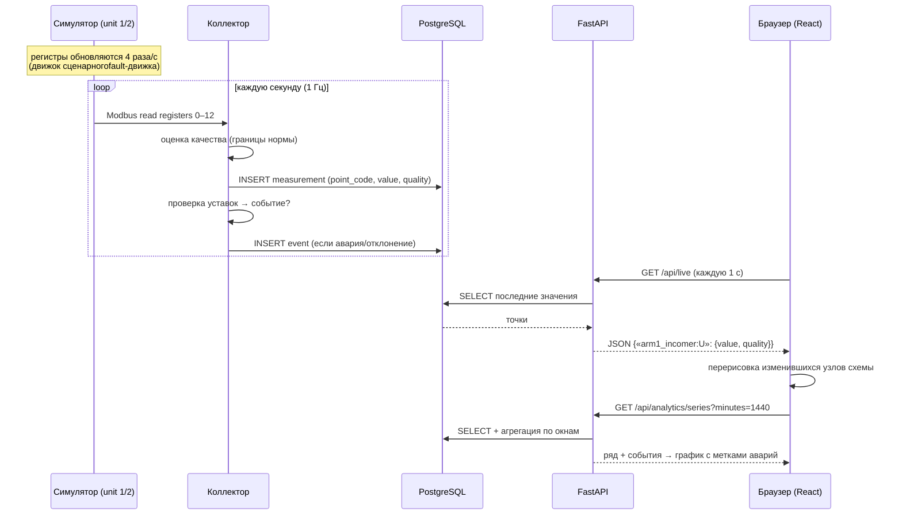
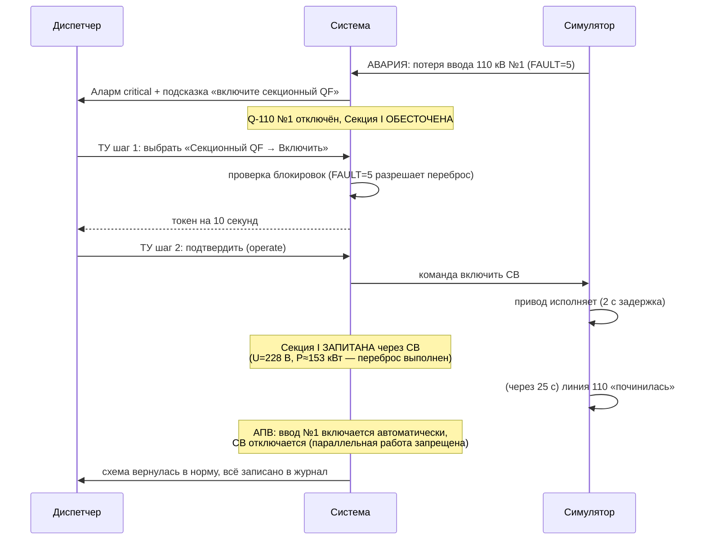
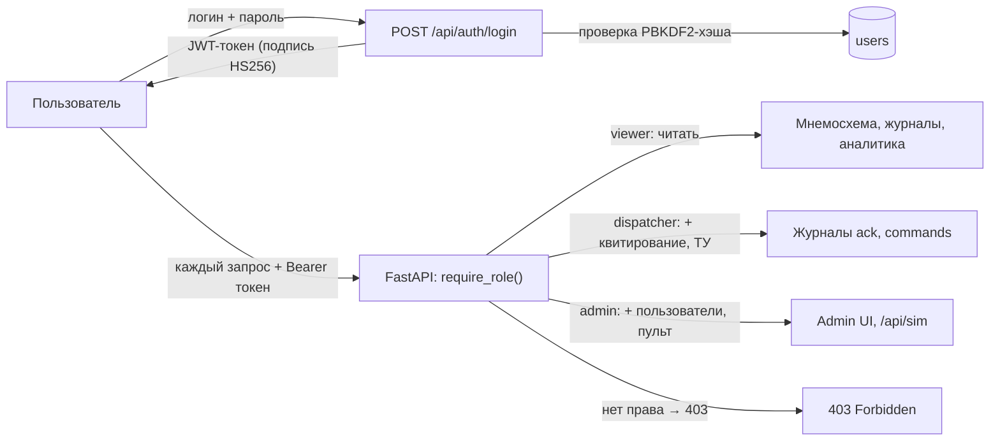
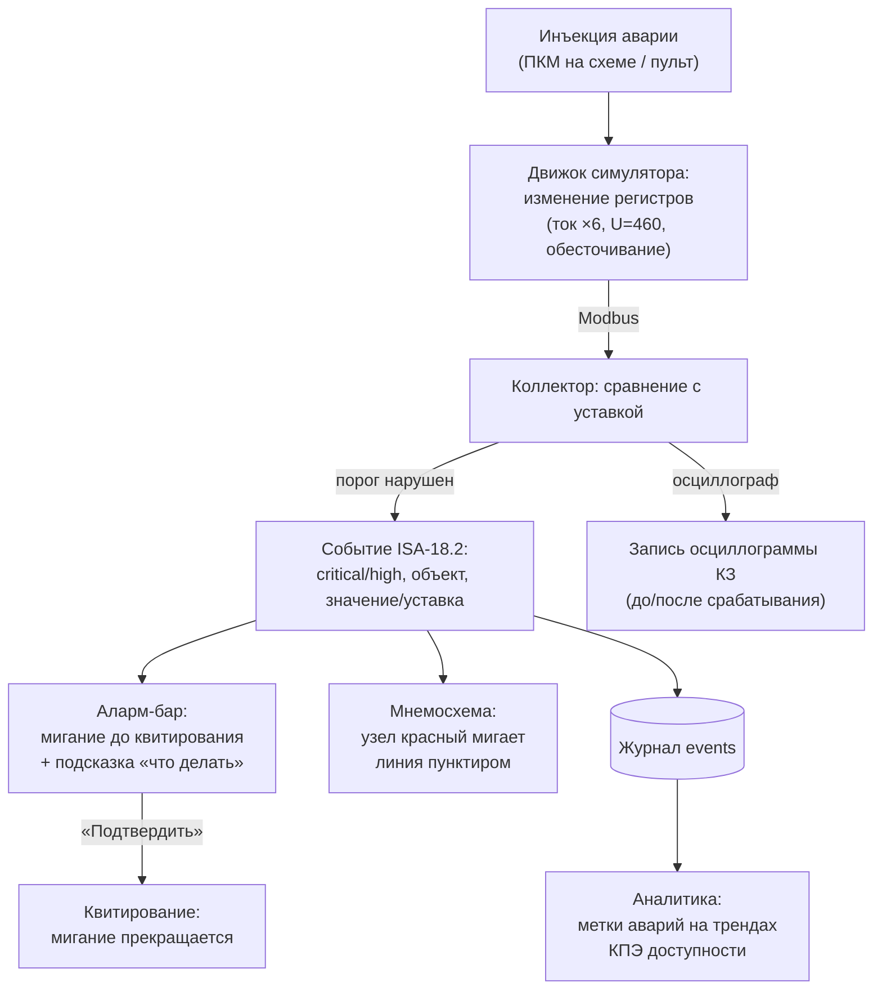

# ПАК «Титан-Энергия» — диаграммы архитектуры

> Все диаграммы — в текстовом виде (Mermaid + ASCII). Открывается в любом
> Markdown-редакторе с поддержкой Mermaid (VS Code, Obsidian, GitHub).
> На собеседовании можно показать этот файл или перерисовать схему на доске.

---

## 1. Общая архитектура: 5 уровней системы

```mermaid
flowchart TB
    subgraph L1["УРОВЕНЬ 1 — ОБОРУДОВАНИЕ (полевой уровень)"]
        SIM["Симулятор подстанции<br/>Modbus TCP :5020<br/>unit 1 = Плечо А · unit 2 = Плечо Б"]
        RELAY["Реле защиты, счётчики,<br/>контроллеры (в будущем —<br/>реальное оборудование)"]
    end

    subgraph L2["УРОВЕНЬ 2 — СБОР ДАННЫХ (коллектор)"]
        COL["Collector: опрос 1 Гц<br/>• чтение регистров 0–12<br/>• оценка качества (good/suspect/bad)<br/>• генератор событий ISA-18.2<br/>• контроль границ (уставки)"]
    end

    subgraph L3["УРОВЕНЬ 3 — ХРАНЕНИЕ (данные)"]
        DB[("PostgreSQL 16<br/>• measurements ~700 тыс.<br/>• events (журнал)<br/>• users (RBAC)<br/>• operator_actions (аудит)")]
    end

    subgraph L4["УРОВЕНЬ 4 — ЛОГИКА (API-сервер)"]
        API["FastAPI (REST + JWT)<br/>• /api/live — телеметрия<br/>• /api/commands — ТУ с блокировками<br/>• /api/analytics — сводки, Шухарт, CUSUM<br/>• /api/sim — пульт (только admin)<br/>• /api/objects — дерево ПС"]
    end

    subgraph L5["УРОВЕНЬ 5 — ИНТЕРФЕЙС (клиенты)"]
        UI["SPA React + TypeScript + ECharts<br/>• Мнемосхема (главный экран)<br/>• Журналы · Аналитика<br/>• Админка · Пульт симулятора"]
    end

    SIM <-->|"Modbus TCP<br/>(промышленный протокол)"| COL
    COL -->|"запись каждую секунду"| DB
    DB <-->|"SQL (async, SQLAlchemy)"| API
    API <-->|"REST + JSON<br/>(JWT-авторизация)"| UI

    style L1 fill:#1b2230,stroke:#556
    style L2 fill:#16202e,stroke:#556
    style L3 fill:#141c28,stroke:#556
    style L4 fill:#121a26,stroke:#556
    style L5 fill:#101622,stroke:#556
```



**Правило уровней**: каждый уровень общается только с соседними. Экраны не
знают про протокол Modbus, коллектор не знает про React. При замене любого
уровня остальные не трогаются.

---

## 2. SCADA-уровень и MES-уровень: что где лежит

По ТЗ система двухуровневая: SCADA (оперативное управление) + MES (анализ).
В нашем прототипе они разделены **функционально**, внутри одного приложения:

```mermaid
flowchart LR
    subgraph SCADA["SCADA-УРОВЕНЬ — «глаза и руки» (реальное время)"]
        direction TB
        MNE["Мнемосхема<br/>однолинейная схема ПС 110/10<br/>динамическая индикация<br/>drill-down по узлам"]
        EVT["Журналы ISA-18.2<br/>аварии / ненорм. режимы /<br/>действия оператора<br/>квитирование"]
        TU["Телеуправление<br/>двухшаговый алгоритм<br/>select → токен 10 с → operate<br/>блокировки на бэкенде"]
        WAVE["Осциллограммы<br/>автоматическая запись<br/>при КЗ"]
    end

    subgraph MES["MES-УРОВЕНЬ — «мозги» (анализ и отчёты)"]
        direction TB
        AN["Аналитика<br/>тренды 5 мин … 7 дней<br/>агрегация больших периодов<br/>метки аварий на графике"]
        SPC["Статконтроль<br/>карта Шухарта (CL±3σ)<br/>CUSUM · гистограммы<br/>время аномалий"]
        KPI["КПЭ<br/>доступность %<br/>число событий / критических<br/>min/max/avg/σ"]
        EXP["Экспорт<br/>CSV / Excel<br/>отчёт инженера"]
    end

    DB[("База данных<br/>PostgreSQL")] --- SCADA
    DB --- MES

    style SCADA fill:#0e1a2a,stroke:#4d9fff
    style MES fill:#0e1c18,stroke:#35c46a
```



| | SCADA-уровень | MES-уровень |
|---|---|---|
| **Вопрос** | «Что происходит СЕЙЧАС?» | «Что происходило и ПОЧЕМУ?» |
| **Время реакции** | секунды (1 Гц) | минуты/дни (аналитика) |
| **Пользователь** | диспетчер (dispatcher) | инженер/менеджер (viewer+) |
| **Экраны** | Мнемосхема, Журналы | Аналитика, Экспорт |
| **Данные** | live-кэш, мгновенные значения | история из PostgreSQL |

---

## 3. Поток данных: от датчика до графика (последовательность)



---

## 4. Модель объекта: мнемосхема ПС 110/10 кВ (однолинейная)

```mermaid
flowchart TB
    IN1["Ввод 110 кВ №1<br/>(arm1_in110)"] --- Q1["Q-110 №1<br/>выключатель 110 кВ"]
    IN2["Ввод 110 кВ №2<br/>(arm2_in110)"] --- Q2["Q-110 №2<br/>выключатель 110 кВ"]

    Q1 --- T1(("T1<br/>трансформатор<br/>110/10 кВ"))
    Q2 --- T2(("T2<br/>трансформатор<br/>110/10 кВ"))

    T1 --- BI1["Ввод 10 кВ №1<br/>(arm1_incomer)<br/>тел.: U, I, P, Q, THD, PF"]
    T2 --- BI2["Ввод 10 кВ №2<br/>(arm2_incomer)<br/>тел.: U, I, P, Q, THD, PF"]

    BI1 --- BUS1["СЕКЦИЯ I (шина)"]
    BI2 --- BUS2["СЕКЦИЯ II (шина)"]

    BUS1 === SQF["СЕКЦИОННЫЙ QF<br/>(нормально ОТКЛЮЧЁН)<br/>переброс при аварии"] === BUS2

    BUS1 --- F1["Ф-1 Насосная"]
    BUS1 --- F2["Ф-2 Вентиляция"]
    BUS1 --- F3["Ф-3 Освещение"]
    BUS1 --- F4["Ф-4 Резерв"]
    BUS2 --- F5["Ф-5 Станочный цех"]
    BUS2 --- F6["Ф-6 Компрессорная"]
    BUS2 --- F7["Ф-7 Освещение"]
    BUS2 --- F8["Ф-8 Резерв"]

    style SQF fill:#2b2416,stroke:#ff9f2e
    style BUS1 fill:#122036,stroke:#2a6fd4
    style BUS2 fill:#122036,stroke:#2a6fd4
```



**Ключевой сценарий** (авария → восстановление):



---

## 5. Структура кода (репозиторий)

```
titan-energy/
├── backend/
│   └── titan/
│       ├── simulator/          # УРОВЕНЬ 1: симулятор оборудования
│       │   ├── engine.py       #   движки плеч, регистры Modbus, инъекции аварий
│       │   └── factory.py      #   модель объекта: ПС → плечи → секции → фидеры
│       ├── collector/          # УРОВЕНЬ 2: сбор данных
│       │   ├── service.py      #   опрос 1 Гц, live-кэш «объект:точка»
│       │   └── events.py       #   генератор событий ISA-18.2 (уставки)
│       ├── models/             # УРОВЕНЬ 3: схемы БД (SQLAlchemy)
│       │   ├── db.py           #   Measurement, Event, User, OperatorAction
│       │   └── session.py      #   движки PostgreSQL / SQLite-тестов
│       ├── api/                # УРОВЕНЬ 4: REST API
│       │   ├── app.py          #   live, events, objects, sim, waveforms
│       │   ├── auth.py         #   JWT, PBKDF2, роли viewer/dispatcher/admin
│       │   ├── commands.py     #   телеуправление: select→operate + блокировки
│       │   ├── analytics.py    #   series, summary, shewhart, cusum, export
│       │   └── waveforms.py    #   осциллограммы при КЗ
│       ├── analytics/          # математика аналитики (stats.py: Шухарт, CUSUM)
│       └── config.py           # .env, таймауты, TITAN_TEST_DB
├── frontend/
│   └── src/
│       ├── pages/              # УРОВЕНЬ 5: экраны
│       │   ├── MnemoPage.tsx   #   мнемосхема (главный, drill-down)
│       │   ├── EventsPage.tsx  #   журналы + квитирование
│       │   ├── AnalyticsPage.tsx # аналитика: тренды, Шухарт, КПЭ
│       │   ├── SimControlPage.tsx # пульт симулятора (admin)
│       │   ├── AdminPage.tsx   #   пользователи + аудит (admin)
│       │   ├── TuDialog.tsx    #   диалог двухшагового ТУ
│       │   └── FaultContextMenu.tsx # ПКМ-меню создания аварии
│       ├── api.ts              # клиент API (типы + запросы)
│       └── App.tsx             # роутинг + сайдбар
├── docs/
│   ├── USER_GUIDE.md           # руководство пользователя
│   ├── DEMO_SCRIPT.md          # сценарий демонстрации
│   └── ARCHITECTURE.md         # этот файл
├── backend/tests/              # 59 автотестов (pytest, 2 батча)
└── SPECIFICATION.md            # полная спецификация (§1–16)
```

---

## 6. Безопасность: контекст аутентификации и прав



Защитные слои:
1. **Пароли** — PBKDF2 с индивидуальной солью (в БД только хэш);
2. **Сессии** — JWT с подписью, время жизни ограничено;
3. **Права** — проверка роли на КАЖДОМ эндпоинте (не в UI!);
4. **Блокировки ТУ** — физика процесса (параллельная работа и т.д.);
5. **Аудит** — operator_actions: кто, когда, что сделал;
6. **Валидация входа** — периоды (0..30 дней), длительности (0..3600 с);
   SQL-инъекции отсечены параметризацией запросов (проверено пентестом).

---

## 7. Поток аварий (от события до осциллограммы)



---

## 8. Цифры для собеседования

| Метрика | Значение |
|---|---|
| Уровней архитектуры | 5 (оборудование → сбор → БД → API → UI) |
| Протокол | Modbus TCP (unit 1/2, регистры 0–12, опрос 1 Гц) |
| БД | PostgreSQL 16 (async, SQLAlchemy), ~700 тыс. измерений |
| Сценариев аварий | 5 (КЗ, перегрузка, перенапряжение, обрыв кабеля, потеря 110) |
| Автотестов | 59 (pytest, 2 батча: 28 + 31) |
| Ролей | 3 (viewer / dispatcher / admin) |
| Экранов | 5 (мнемосхема, журналы, аналитика, админка, пульт) |
| Точек телеметрии на объект | 7 (U, I, P, Q, THDu, THDi, PF) + BREAKER, FAULT |
| Частота обновления UI | 1 с (live), 5 с (аналитика), 4 раза/с (движок симулятора) |
